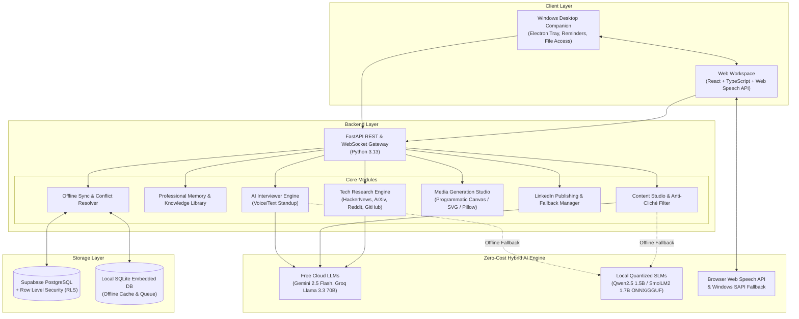
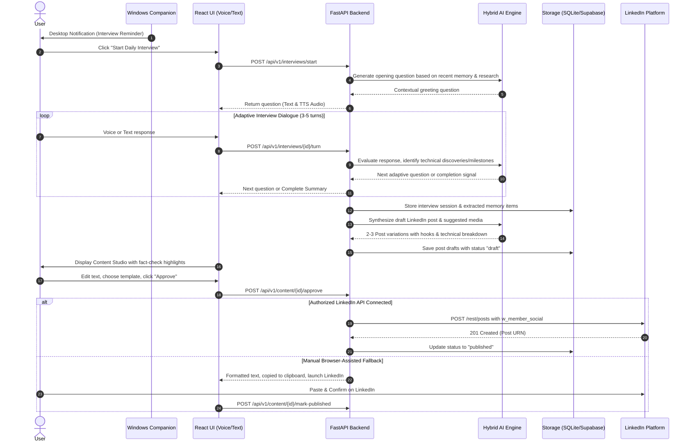

# System Architecture Specification

> **Status:** This is the target architecture. The current implementation is a local FastAPI/SQLite backend and React frontend with Phase 2 profile and professional-memory features. Cloud synchronization, AI services, LinkedIn integrations, and the Electron desktop companion are not implemented yet.

## 1. High-Level Architectural Overview

The **Personal Branding AI Agent** utilizes a modern, resilient, hybrid desktop-and-cloud architecture designed for:
- Zero operational cost (100% free services and open-source models).
- Total data privacy and explicit human approval for all outward actions.
- Offline-first resilience with local SQLite caching and cloud Supabase synchronization.
- Seamless dual-mode interaction (native Windows desktop companion + responsive web workspace).

---

## 2. Component Breakdown

### 2.1 Client Layer
- **Electron Windows Desktop Companion**:
  - Resides in the Windows system tray (`tray.js`).
  - Executes background interview reminders every 15 minutes until daily interview completion.
  - Manages Windows registry run-at-startup preferences.
  - Implements safe, read-only local folder inspection using explicit native folder dialogs.
  - Embeds the React application seamlessly.
- **React 18 + TypeScript Web Workspace**:
  - Modern, responsive SPA bundled with Vite.
  - 12 Dedicated Workspaces: Home, AI Interviewer, Content Studio, Media Studio, Content Calendar, Research Engine, Professional Memory, Portfolio Manager, Networking Assistant, Analytics, Profile Manager, Settings & Privacy.
  - Native Web Speech API integration for 100% free, low-latency, in-browser speech recognition and synthesis.
  - Strict human approval checkpoints preceding any external publishing or clipboard operation.

### 2.2 Backend Gateway (FastAPI)
- **FastAPI Core**:
  - Asynchronous, high-performance Python 3.13 backend.
  - Strict Pydantic v2 data validation and automatic OpenAPI documentation generation.
  - Modular routers mapped to system features.
- **AI Interviewer Service**:
  - Maintains conversation turn states.
  - Dynamically evaluates if user statements represent *implemented*, *studied*, *explored*, or *discovered* items.
  - Detects interview completion naturally once sufficient valuable points are gathered.
- **Technology Research Service**:
  - Asynchronously pulls daily tech discussions from Hacker News (Firebase API), ArXiv AI papers, Reddit tech channels, and GitHub trending feeds.
  - Runs automated credibility checks and source verification.
- **Content Creation Service**:
  - Employs structured prompts that reject generic "broetry" and robotic AI hype.
  - Ingests user's actual interview statements and professional memory to produce fact-checked drafts.
- **Media Generation Service**:
  - 100% free programmatic asset generation using Pillow, Matplotlib, SVG, and HTML Canvas export.
  - Creates LinkedIn carousels, architecture diagrams, code snippet cards, and infographics without paid image generation APIs.
- **LinkedIn Publishing Service**:
  - Hybrid design: direct API publishing via official `w_member_social` endpoint when OAuth credentials are provided.
  - High-fidelity manual fallback: formats the post with preview, copies text to clipboard, and deep-links directly to LinkedIn sharing modal.

### 2.3 Hybrid AI Engine (Zero-Cost Strict Architecture)
- **Primary Cloud AI (Free Tiers)**:
  - Google Gemini 2.5 Flash / Flash-Lite: 15 RPM, 1,500 RPD free tier for fast, complex reasoning and voice interview dialogue.
  - Groq Cloud API: Ultra-fast Llama 3.3 70B & Llama 3.1 8B for instant post drafting and research classification.
- **Local AI Fallback (CPU-Optimized SLM)**:
  - Sized for the user's hardware profile (~4 GB available RAM, 14 CPU cores, integrated Intel GPU).
  - Uses quantized 1.5B–3B parameter models (e.g., SmolLM2-1.7B, Qwen2.5-1.5B) via ONNX Runtime / GGUF on CPU with AVX2.
  - Operates completely offline for classification, basic drafting, and prompt templating.

### 2.4 Data & Storage Architecture
- **Cloud Database (Supabase)**:
  - PostgreSQL hosted on Supabase Free Tier (500 MB database, 1 GB asset storage).
  - Row Level Security (RLS) ensures total tenant isolation (`auth.uid() = user_id`).
- **Local Offline Database (SQLite)**:
  - SQLite database (`brand_agent.db`) mirroring essential entity tables.
  - Two-way synchronization engine tracks revision timestamps and queues offline actions in a `sync_queue` table.

---

## 3. Data Flow Pipelines

### 3.1 Daily Interview to Published Post Pipeline

---

## 4. Security & Isolation Boundaries
- **No Hardcoded Secrets**: All keys retrieved from environment variables or encrypted OS keystore.
- **Read-Only Local Scanning**: Local folder parsing strictly excludes `.git`, `.env`, hidden credentials, and binary executables.
- **Multi-User Isolation**: Database policies strictly enforce user data segregation via Supabase RLS.
- **Zero Autonomous Public Actions**: Zero posts, comments, or connection requests are dispatched without manual user approval.
