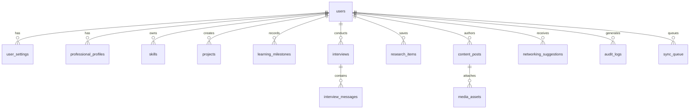

# Database Schema Specification

> **Status:** This document includes the planned cloud schema. The current application uses local SQLite; Supabase, authentication, and Row Level Security policies are not implemented.

This document defines the proposed relational schema for **Supabase PostgreSQL** (Cloud) and **SQLite** (Local Offline).

---

## 1. Schema Principles
- **Multi-User Prepared**: Every entity table contains `user_id` linked to the authentication user.
- **Strict Row-Level Security (RLS)**: PostgreSQL policies enforce that users can only read, insert, update, or delete their own records.
- **Offline Mirroring**: SQLite uses identical column definitions and types (`TEXT`, `INTEGER`, `REAL`, `JSON`) to allow seamless local synchronization.

---

## 2. Entity-Relationship Diagram



---

## 3. SQL Table Definitions (PostgreSQL & SQLite)

### 3.1 Users and Authentication
```sql
CREATE TABLE IF NOT EXISTS users (
    id UUID PRIMARY KEY DEFAULT gen_random_uuid(),
    email TEXT UNIQUE NOT NULL,
    full_name TEXT NOT NULL,
    onboarding_completed BOOLEAN NOT NULL DEFAULT FALSE,
    created_at TIMESTAMPTZ DEFAULT NOW(),
    updated_at TIMESTAMPTZ DEFAULT NOW()
);
```

### 3.2 User Settings
```sql
CREATE TABLE IF NOT EXISTS user_settings (
    id UUID PRIMARY KEY DEFAULT gen_random_uuid(),
    user_id UUID NOT NULL REFERENCES users(id) ON DELETE CASCADE,
    theme TEXT DEFAULT 'dark' CHECK (theme IN ('dark', 'light', 'system')),
    reminder_interval_mins INTEGER DEFAULT 15,
    reminders_enabled BOOLEAN DEFAULT TRUE,
    preferred_ai_provider TEXT DEFAULT 'gemini' CHECK (preferred_ai_provider IN ('gemini', 'groq', 'local')),
    offline_mode BOOLEAN DEFAULT FALSE,
    github_username TEXT,
    created_at TIMESTAMPTZ DEFAULT NOW(),
    updated_at TIMESTAMPTZ DEFAULT NOW()
);
```

### 3.3 Professional Profile
```sql
CREATE TABLE IF NOT EXISTS professional_profiles (
    id UUID PRIMARY KEY DEFAULT gen_random_uuid(),
    user_id UUID NOT NULL REFERENCES users(id) ON DELETE CASCADE,
    headline TEXT,
    summary TEXT,
    career_direction TEXT,
    target_audience TEXT,
    writing_voice_notes TEXT,
    seniority_level TEXT,
    created_at TIMESTAMPTZ DEFAULT NOW(),
    updated_at TIMESTAMPTZ DEFAULT NOW()
);
```

### 3.4 Skills (With Strict Proficiency Hierarchy)
```sql
CREATE TABLE IF NOT EXISTS skills (
    id UUID PRIMARY KEY DEFAULT gen_random_uuid(),
    user_id UUID NOT NULL REFERENCES users(id) ON DELETE CASCADE,
    name TEXT NOT NULL,
    category TEXT, -- e.g., 'Backend', 'AI/ML', 'DevOps', 'Frontend'
    proficiency_level TEXT NOT NULL CHECK (proficiency_level IN ('implemented', 'studied', 'explored', 'discovered')),
    verified_by_project BOOLEAN DEFAULT FALSE,
    evidence_notes TEXT,
    created_at TIMESTAMPTZ DEFAULT NOW(),
    updated_at TIMESTAMPTZ DEFAULT NOW()
);
```

### 3.5 Projects & Portfolio
```sql
CREATE TABLE IF NOT EXISTS projects (
    id UUID PRIMARY KEY DEFAULT gen_random_uuid(),
    user_id UUID NOT NULL REFERENCES users(id) ON DELETE CASCADE,
    title TEXT NOT NULL,
    description TEXT,
    maturity TEXT NOT NULL CHECK (maturity IN ('completed', 'in_development', 'experiment', 'learning_exercise', 'planned')),
    github_url TEXT,
    repo_name TEXT,
    tech_stack JSONB DEFAULT '[]'::jsonb,
    key_achievements JSONB DEFAULT '[]'::jsonb,
    screenshots JSONB DEFAULT '[]'::jsonb,
    created_at TIMESTAMPTZ DEFAULT NOW(),
    updated_at TIMESTAMPTZ DEFAULT NOW()
);
```

### 3.6 Learning Milestones & Technical Challenges
```sql
CREATE TABLE IF NOT EXISTS learning_milestones (
    id UUID PRIMARY KEY DEFAULT gen_random_uuid(),
    user_id UUID NOT NULL REFERENCES users(id) ON DELETE CASCADE,
    title TEXT NOT NULL,
    description TEXT,
    category TEXT, -- e.g., 'Bug Resolved', 'Architecture Decision', 'Library Mastered'
    milestone_date DATE NOT NULL,
    lessons_learned TEXT,
    created_at TIMESTAMPTZ DEFAULT NOW()
);
```

### 3.7 AI Interviews
```sql
CREATE TABLE IF NOT EXISTS interviews (
    id UUID PRIMARY KEY DEFAULT gen_random_uuid(),
    user_id UUID NOT NULL REFERENCES users(id) ON DELETE CASCADE,
    interview_date DATE NOT NULL,
    mode TEXT DEFAULT 'text' CHECK (mode IN ('text', 'voice')),
    completed BOOLEAN DEFAULT FALSE,
    summary TEXT,
    extracted_topics JSONB DEFAULT '[]'::jsonb,
    created_at TIMESTAMPTZ DEFAULT NOW(),
    updated_at TIMESTAMPTZ DEFAULT NOW()
);

CREATE TABLE IF NOT EXISTS interview_messages (
    id UUID PRIMARY KEY DEFAULT gen_random_uuid(),
    interview_id UUID NOT NULL REFERENCES interviews(id) ON DELETE CASCADE,
    sender TEXT NOT NULL CHECK (sender IN ('user', 'ai')),
    content TEXT NOT NULL,
    audio_url TEXT,
    created_at TIMESTAMPTZ DEFAULT NOW()
);
```

### 3.8 Technology Research Items
```sql
CREATE TABLE IF NOT EXISTS research_items (
    id UUID PRIMARY KEY DEFAULT gen_random_uuid(),
    user_id UUID NOT NULL REFERENCES users(id) ON DELETE CASCADE,
    title TEXT NOT NULL,
    summary TEXT,
    source_name TEXT NOT NULL, -- 'HackerNews', 'ArXiv', 'Reddit', 'GitHub'
    source_url TEXT NOT NULL,
    credibility_score REAL DEFAULT 0.8,
    category TEXT,
    trend_classification TEXT CHECK (trend_classification IN ('interview_topic', 'research_note', 'educational_post', 'industry_trend', 'ignored')),
    created_at TIMESTAMPTZ DEFAULT NOW()
);
```

### 3.9 Content Posts & Publishing Workflow
```sql
CREATE TABLE IF NOT EXISTS content_posts (
    id UUID PRIMARY KEY DEFAULT gen_random_uuid(),
    user_id UUID NOT NULL REFERENCES users(id) ON DELETE CASCADE,
    interview_id UUID REFERENCES interviews(id),
    title TEXT NOT NULL,
    topic TEXT,
    content_category TEXT NOT NULL, -- 'tutorial', 'concept', 'project_update', 'learning_experience', 'technical_opinion'
    draft_versions JSONB DEFAULT '[]'::jsonb,
    final_content TEXT NOT NULL,
    hashtags JSONB DEFAULT '[]'::jsonb,
    status TEXT NOT NULL DEFAULT 'draft' CHECK (status IN ('draft', 'fact_checked', 'pending_approval', 'approved', 'scheduled', 'published', 'rejected')),
    scheduled_for TIMESTAMPTZ,
    published_at TIMESTAMPTZ,
    linkedin_post_id TEXT,
    approval_log JSONB DEFAULT '{}'::jsonb,
    created_at TIMESTAMPTZ DEFAULT NOW(),
    updated_at TIMESTAMPTZ DEFAULT NOW()
);
```

### 3.10 Media Assets
```sql
CREATE TABLE IF NOT EXISTS media_assets (
    id UUID PRIMARY KEY DEFAULT gen_random_uuid(),
    user_id UUID NOT NULL REFERENCES users(id) ON DELETE CASCADE,
    post_id UUID REFERENCES content_posts(id) ON DELETE SET NULL,
    asset_type TEXT NOT NULL CHECK (asset_type IN ('infographic', 'diagram', 'carousel', 'chart', 'showcase')),
    file_path TEXT NOT NULL,
    storage_url TEXT,
    metadata JSONB DEFAULT '{}'::jsonb,
    created_at TIMESTAMPTZ DEFAULT NOW()
);
```

### 3.11 Networking & Opportunity Assistant
```sql
CREATE TABLE IF NOT EXISTS networking_suggestions (
    id UUID PRIMARY KEY DEFAULT gen_random_uuid(),
    user_id UUID NOT NULL REFERENCES users(id) ON DELETE CASCADE,
    person_name TEXT NOT NULL,
    profile_url TEXT,
    target_role TEXT,
    reason TEXT NOT NULL,
    connection_note_draft TEXT,
    comment_draft TEXT,
    status TEXT DEFAULT 'suggested' CHECK (status IN ('suggested', 'approved', 'sent_manually', 'dismissed')),
    created_at TIMESTAMPTZ DEFAULT NOW()
);
```

### 3.12 Audit Logging & Offline Sync
```sql
CREATE TABLE IF NOT EXISTS audit_logs (
    id UUID PRIMARY KEY DEFAULT gen_random_uuid(),
    user_id UUID NOT NULL REFERENCES users(id) ON DELETE CASCADE,
    action_type TEXT NOT NULL,
    description TEXT NOT NULL,
    metadata JSONB DEFAULT '{}'::jsonb,
    created_at TIMESTAMPTZ DEFAULT NOW()
);

CREATE TABLE IF NOT EXISTS sync_queue (
    id UUID PRIMARY KEY DEFAULT gen_random_uuid(),
    user_id UUID NOT NULL REFERENCES users(id) ON DELETE CASCADE,
    entity_type TEXT NOT NULL,
    entity_id UUID NOT NULL,
    operation TEXT NOT NULL CHECK (operation IN ('INSERT', 'UPDATE', 'DELETE')),
    payload JSONB NOT NULL,
    status TEXT DEFAULT 'pending' CHECK (status IN ('pending', 'synced', 'failed')),
    created_at TIMESTAMPTZ DEFAULT NOW()
);
```

---

## 4. Row Level Security (RLS) Policies

All tables in PostgreSQL have Row Level Security enabled:

```sql
ALTER TABLE user_settings ENABLE ROW LEVEL SECURITY;
ALTER TABLE professional_profiles ENABLE ROW LEVEL SECURITY;
ALTER TABLE skills ENABLE ROW LEVEL SECURITY;
ALTER TABLE projects ENABLE ROW LEVEL SECURITY;
ALTER TABLE learning_milestones ENABLE ROW LEVEL SECURITY;
ALTER TABLE interviews ENABLE ROW LEVEL SECURITY;
ALTER TABLE interview_messages ENABLE ROW LEVEL SECURITY;
ALTER TABLE research_items ENABLE ROW LEVEL SECURITY;
ALTER TABLE content_posts ENABLE ROW LEVEL SECURITY;
ALTER TABLE media_assets ENABLE ROW LEVEL SECURITY;
ALTER TABLE networking_suggestions ENABLE ROW LEVEL SECURITY;
ALTER TABLE audit_logs ENABLE ROW LEVEL SECURITY;
ALTER TABLE sync_queue ENABLE ROW LEVEL SECURITY;

-- Policy template applied across all user tables:
CREATE POLICY user_isolation_policy ON user_settings
    FOR ALL
    USING (auth.uid() = user_id)
    WITH CHECK (auth.uid() = user_id);
```
